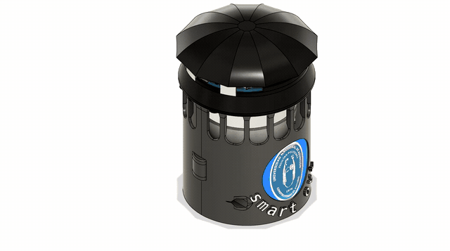
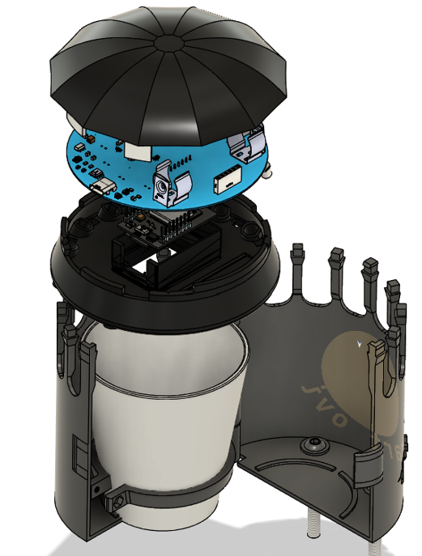
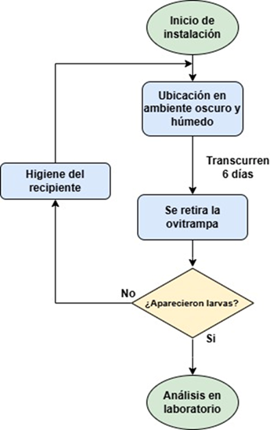
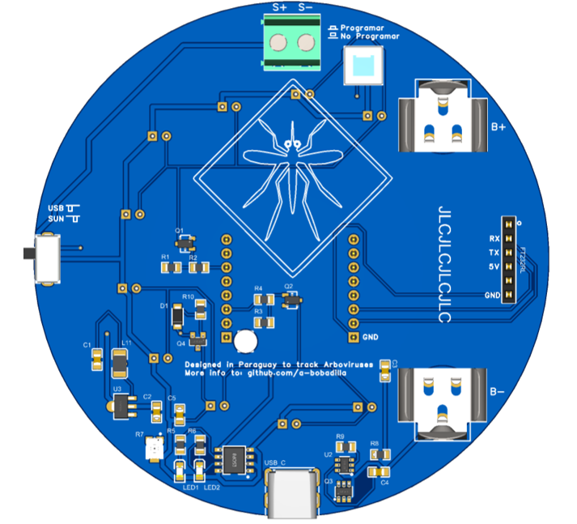
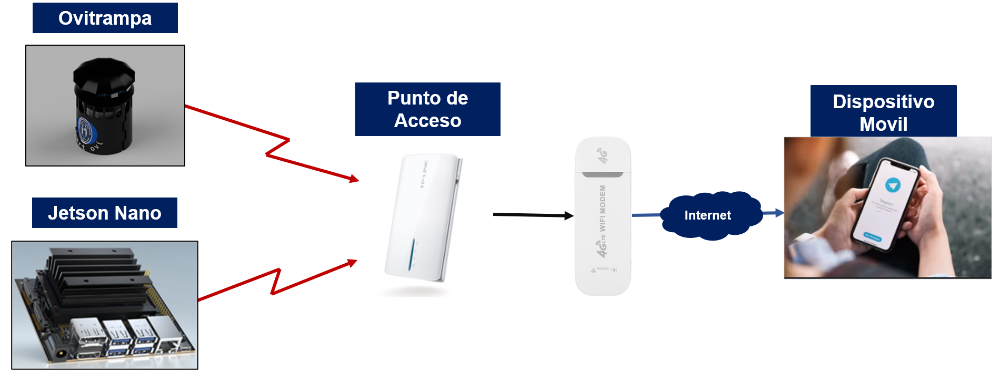

# SmartOVI: Automated and Continuous Ovitrap Monitoring System

[](./LICENSE)
[](https://www.python.org/downloads/)
[](https://www.nvidia.com/en-us/autonomous-machines/embedded-systems/jetson-nano/)
[](https://www.espressif.com/)
[](https://mqtt.org/)

---

## Executive Summary

Vector-borne diseases such as **Dengue, Zika, and Chikungunya** represent major global public health challenges, primarily propagated by the *Aedes aegypti* mosquito. Conventional epidemiological vector surveillance depends heavily on traditional, passive oviposition traps (ovitraps). However, standard methods require labor-intensive, periodic physical visits by healthcare agents to manually retrieve substrates, transport specimens to laboratories, and perform microscope counts. This introduces multi-day reporting delays, high operational expenses, and vulnerabilities to human error.

**SmartOVI** revolutionizes this paradigm through an autonomous, IoT-enabled, Edge Computing ovitrap system. By combining tailored additive manufacturing (3D-printed housing), an embedded wireless optical capture module (ESP32-CAM), custom low-power energy management, and on-device deep learning object detection (YOLOv5 on NVIDIA Jetson Nano), SmartOVI delivers **continuous, real-time larvae monitoring and automated epidemiological alerts** directly to public health authorities via Telegram.

---

## Narrative of the SmartOVI Ecosystem & Field Operation

### 1. Mechanical Concept and 3D Assembly

The mechanical foundation of SmartOVI is designed to withstand harsh outdoor conditions while recreating the ideal dark, humid micro-climate that female *Aedes aegypti* mosquitoes naturally seek for egg deposition. The modular housing includes a conical protective lid shielding the internal optical system from precipitation and debris, an internal water vessel, and an electronic chamber.

<p align="center">
  
  <br/>
  <em>Figure 1: 3D CAD visualization and assembly sequence of the SmartOVI mechanical structure.</em>
  <br/>
  <sub><em>High-definition original animation: <a href="assets/ovitrampa.mp4">assets/ovitrampa.mp4</a></em></sub>
</p>

The chassis is optimized for FDM (Fused Deposition Modeling) 3D printing using Polylactic Acid (PLA), followed by surface sealing and protective weatherproofing paint to extend field longevity.

---

### 2. Internal Architecture: The Opened Ovitrap

Opening the SmartOVI reveals an integrated multi-tiered architecture that isolates sensitive electronic components from the aquatic habitat beneath.

<p align="center">
  
  <br/>
  <em>Figure 2: Sample view of the opened SmartOVI unit, displaying the optical chamber, lighting mount, and internal water vessel.</em>
</p>

Key functional elements visible inside include:
- **Oviposition Chamber & Water Vessel:** A removable inner container holding clean water up to two-thirds (2/3) capacity alongside a specialized oviposition substrate (wooden paddle or textured strip) to attract gravid mosquitoes.
- **Overhead Optical Fixture:** A fixed downward-facing mount securing the ESP32-CAM module at a calibrated focal distance from the water's surface.
- **70° Angled LED Lighting System:** Illuminators positioned at a 70° oblique incidence angle relative to the water plane. This geometry mitigates specular reflection and glare back into the camera lens while casting sharp silhouettes and illumination contours on mosquito larvae swimming or resting near the surface.
- **Hermetic Electronic Isolation:** Barrier geometry that prevents condensation and moisture from penetrating the circuit enclosure.

---

### 3. Operational Cycle and System Flowchart

The system follows an automated sensing and decision-making pipeline engineered for energy conservation and rapid anomaly reporting.

<p align="center">
  
  <br/>
  <em>Figure 3: System flowchart detailing scheduled capture, MQTT transmission, Edge AI inference, and alert notification.</em>
</p>

The operational journey progresses through the following stages:
1. **Scheduled Wakeup & Trigger:** The ESP32-CAM micro-controller wakes periodically from deep sleep (or operates on timed intervals).
2. **Synchronized Lighting & Capture:** The camera activates the custom LED circuit for a fraction of a second, captures a high-resolution 640x480 JPEG frame under uniform illumination, and immediately powers down the LEDs to preserve battery charge.
3. **MQTT Telemetry Transmission:** The frame is encoded and published as a binary/Base64 payload over MQTT to the broker running on the local edge network (`smartovi/ovitramp1/imagen`), accompanied by diagnostic heartbeat messages (`smartovi/ovitramp1/status`).
4. **Edge Computing Ingestion (Jetson Nano):** The central hub receives the image stream through a Node-RED execution pipeline and local archiving daemon (`smartovibot.py`).
5. **AI Inference (YOLOv5s):** A lightweight convolutional object detection model scans the frame to identify and localize mosquito larvae.
6. **Decision & Alert Dispatch:**
   - If `larvae_count == 0`, the image is indexed for telemetry history.
   - If `larvae_count > 0`, an immediate alert is generated and dispatched to field epidemiologists through the Telegram Bot (`SmartOvi`). The notification includes the annotated image with bounding boxes, the exact larvae count, timestamp, and geolocation coordinates.

---

### 4. Custom Power and Control Electronics (PCB)

Field autonomy demands dedicated power regulation and intelligent peripheral control. A custom PCB was engineered in EasyEDA to bridge the ESP32-CAM, energy storage, and lighting subsystems.

<p align="center">
  
  <br/>
  <em>Figure 4: Custom printed circuit board (PCB) for charge management, battery backup, and switched LED illumination.</em>
</p>

Key electrical characteristics include:
- **Dual Power Supply Options:** Operates either from an external +12V DC auxiliary supply or standard USB (+5V).
- **Lithium-Ion Charge Management:** Features an integrated TP4056 charge controller paired with a rechargeable 18650 Lithium battery (~3000 mAh), providing constant-current/constant-voltage (CC/CV) charging up to 4.2V and built-in under-voltage protection.
- **Transistor-Switched Illumination:** Utilizes an S8050 NPN bipolar junction transistor driven by a GPIO pin on the ESP32. High-brightness LEDs are energized exclusively during optical acquisition, minimizing power consumption during idle periods.
- **Decoupling and Voltage Stabilization:** Dedicated filtering capacitors ensure low-noise power delivery to the OV2640 image sensor, preventing image artifacts during WiFi transmission bursts.

---

### 5. Application Stage & Strategic Field Deployment

The SmartOVI architecture is designed for strategic placement across urban, peri-domestic, and rural epidemic hotspots where *Aedes aegypti* vector densities are highest.

<p align="center">
  
  <br/>
  <em>Figure 5: Field deployment schematic illustrating decentralized ovitraps, wireless edge aggregation, and remote Telegram notification to health teams.</em>
</p>

#### Field Placement Guidelines
- **Micro-Environment Selection:** Traps should be placed in humid, dark, shaded areas sheltered from direct rainfall, heavy wind currents, and open sunlight (e.g., covered patios, perimeter gardens, beneath eaves).
- **Secure Mounting:** Utilize the built-in mechanical mounting brackets to firmly anchor the ovitrap to a wall, fence, or stable base.
- **Network Aggregation:** Distributed ovitraps connect over local WiFi to a central portable router / 4G cellular gateway (such as the TP-Link TL-MR3040), routing frames seamlessly to the on-site NVIDIA Jetson Nano edge station.

#### The 6-Day Preventive Maintenance Lifecycle
Because *Aedes aegypti* eggs typically hatch into larvae and progress to pupae and adults within 7 to 10 days under tropical conditions, SmartOVI enforces a **mandatory 6-day field maintenance protocol** (or immediate intervention following a positive alert):
1. **Physical Inspection:** Health personnel visit the alerted device.
2. **Larvae Harvesting:** Any detected larvae are safely extracted for entomological strain classification and resistance profiling.
3. **Chamber Cleaning & Refilling:** The container is washed to prevent biological bio-film accumulation, refilled to 2/3 capacity with clean water, and supplied with fresh oviposition substrate.
4. **Technical Check:** Battery state-of-charge is validated and the camera lens is wiped clean of airborne dust or moisture.

This structured timeline turns the ovitrap into a **lethal sink**: mosquitoes lay their eggs in the trap, but larvae are detected and eliminated *before* they can ever mature into biting, virus-transmitting adults.

---

## Technical Specifications & Hardware Implementation

### 1. Mechanical Fabrication (3D Printing)
All printable 3D models are located in the [`./3D Print/`](./3D%20Print/) directory:
- `Tapa Complex.obj`: Main structural cover and electronics housing.
- `Tapa Lateral 1.obj` & `Tapa lateral 2.obj`: Lateral covers and mounting brackets.

**Recommended 3D Print Settings:**
- **Material:** PLA (Polylactic Acid) or PETG for enhanced UV/thermal stability.
- **Infill Density:** 20% (Gyroid or Grid).
- **Perimeters / Shells:** 3 layers.
- **Layer Height:** 0.20 mm.
- **Post-processing:** Sanding, acrylic putty application, and weather-resistant outdoor spray coating.

### 2. Embedded Firmware (ESP32-CAM)
The ESP32 firmware source code resides in [`ESP32 CAM/principal.ino`](./ESP32%20CAM/principal.ino):
- **Camera Resolution:** `FRAMESIZE_640X480`, format `PIXFORMAT_JPEG`.
- **Quality Factor:** JPEG compression quality set to 12 for optimal balance between network throughput and computer vision sharpness.
- **Connectivity:** FreeRTOS Wi-Fi stack publishing to topics:
  - `smartovi/ovitramp1/imagen` (payload: binary JPEG frame)
  - `smartovi/ovitramp1/status` (payload: diagnostic timestamp string)

---

## Software Installation & Edge AI Deployment

The central edge inference node runs on an **NVIDIA Jetson Nano** (or compatible Linux-based edge computer).

### 1. Prerequisites & Dependencies
Clone the repository and install the required Python packages:

```bash
git clone https://github.com/a-bobadilla/Smart-Ovitramp.git
cd Smart-Ovitramp

python3 -m venv .venv
source .venv/bin/activate
pip install -r requirements.txt
```

### 2. MQTT Broker Configuration
Install and enable Mosquitto on the edge node:

```bash
sudo apt update
sudo apt install -y mosquitto mosquitto-clients
sudo systemctl enable mosquitto
sudo systemctl start mosquitto
```

### 3. Node-RED Inference Pipeline
Install Node-RED for workflow orchestration and Telegram integration:

```bash
bash <(curl -sL https://raw.githubusercontent.com/node-red/linux-installers/master/deb/update-nodejs-and-nodered)
node-red-start
```

Configure the flow nodes:
1. **MQTT In:** Subscribes to `smartovi/ovitramp1/imagen`.
2. **Buffer Preprocessing:** Decodes incoming byte buffers.
3. **YOLOv5 Inference (TensorFlow / TensorRT / ONNX):** Executes larvae detection bounding box predictions.
4. **Telegram Node:** Formats detection summaries and dispatches alerts with attached images to authorized health agent chat IDs.

### 4. Background Telemetry Collector
To archive dataset samples for model retraining or audit trails:

```bash
python smartovibot.py
```

---

## Dataset & Neural Network Training

- The labelled training data is maintained in [`./dataset/`](./dataset/) alongside Pascal VOC annotations (`.xml`).
- Image processing and exploratory analysis notebooks can be found in [`./notebooks/`](./notebooks/):
  - [`imgProcessSmartOvi.ipynb`](./notebooks/imgProcessSmartOvi.ipynb): Color space transformations, thresholding, and morphological filtering.
  - [`ProcesarResultados.ipynb`](./notebooks/ProcesarResultados.ipynb): Performance metrics and validation curve generation.
- Model architecture: **YOLOv5s** trained for 300 epochs on 640x480 resolution images under controlled illumination (pH 6 water conditions).

---

## Comprehensive Implementation Manual

For step-by-step assembly diagrams, field deployment procedures, and troubleshooting guides, consult the official manual:

- 📖 [**Manual Ovitrampa.pptx**](./Manual%20Ovitrampa.pptx)

---

## Troubleshooting Guide

| Issue | Probable Cause | Corrective Action |
| :--- | :--- | :--- |
| **No messages / alerts received** | Depleted 18650 battery; Wi-Fi out of range. | Recharge or replace battery; verify router coverage and RSSI. |
| **Dark or black frames** | LED driver failure or loose connection. | Verify S8050 transistor switching and wiring to LED terminals. |
| **False positive alerts** | Large organic floating debris in water vessel. | Clean container and refill with clean water; prune debris. |
| **Unfocused or cloudy images** | Condensation, dust, or spiderwebs on lens. | Clean the camera optical window with a microfiber cloth. |

---

## Authors & Academic Credits

This project was developed as a graduation thesis project for the **Electronic Engineering Degree (Specialization in Mechatronics)** at the:

**Facultad Politécnica – Universidad Nacional de Asunción ([FPUNA](https://www.pol.una.py/))**  
San Lorenzo, Paraguay  

- **Author:** Guillermo Ariel Bobadilla ([@a-bobadilla](https://github.com/a-bobadilla))
